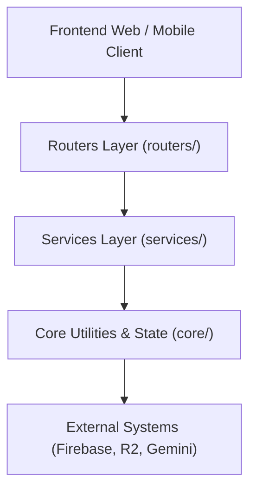

# Quy Chuẩn Lập Trình & Đóng Góp Mã Nguồn (Code Style & Engineering Conventions)

Tài liệu này xác lập quy chuẩn kỹ thuật chính thức cho dự án **HocNhanhTN (Học Nhanh Trắc Nghiệm)** nhằm đảm bảo tính nhất quán, bảo mật, khả năng mở rộng (scalability) và khả năng bảo trì lâu dài (maintainability).

---

## 1. Ngôn ngữ & Quy Tắc Đặt Tên (Naming & Language Conventions)

### 1.1. Mã nguồn & Định danh (Code & Identifiers) - 100% Tiếng Anh
- Toàn bộ tên biến, tên hàm, tên lớp, tên module, tên router và các trường dữ liệu API (JSON keys) **bắt buộc dùng tiếng Anh**.
- Không đặt tên biến tiếng Việt không dấu (như `cau_hoi`, `dap_an_dung`) hoặc nửa Anh nửa Việt (`quiz_dapan`).

| Thành phần | Quy tắc đặt tên | Ví dụ chuẩn | Ví dụ không chuẩn |
| :--- | :--- | :--- | :--- |
| **Biến & Hàm** | `snake_case` | `verify_and_complete_session()`, `user_id` | `kiemTraSession()`, `dapan_id` |
| **Lớp (Class) & Model** | `PascalCase` | `ExamSessionService`, `BoundedTTLCache` | `exam_session_service`, `CacheManager` |
| **Hằng số (Constants)** | `UPPER_SNAKE_CASE` | `QUIZ_CACHE`, `SECRET_KEY`, `TASK_CACHE_DIR` | `quizCache`, `task_cache_dir` |
| **Module / File** | `snake_case` | `auth_service.py`, `rate_limiter.py` | `AuthService.py`, `rateLimiter.py` |
| **API Endpoints** | `snake_case` / `kebab-case` | `/api/auth/login`, `/api/student/submit_exam` | `/api/auth/LoginUser`, `/api/nop_bai` |

### 1.2. Thông Điệp Người Dùng & Docstrings - Tiếng Việt Chuẩn Mực
- **Thông báo hiển thị UI / API response error message**: Sử dụng Tiếng Việt có dấu chuẩn, rõ ràng, mang tính sư phạm và hỗ trợ người dùng.
- **Docstrings & Comments**: Tiếng Việt có dấu hoặc Tiếng Anh kỹ thuật. Giữ văn phong cô đọng, nêu rõ mục đích, tham số đầu vào và kiểu trả về.

---

## 2. Kiến Trúc Phân Lớp (Layered Architecture Rules)

Dự án áp dụng mô hình phân lớp rõ ràng để tránh hiện tượng "God Module" và "Circular Dependency":



1. **`core/` (Lớp lõi)**:
   - Chứa cấu hình (`config.py`), hạ tầng cache (`cache.py`), task store (`task_store.py`), bảo mật (`security.py`), rate limiter (`rate_limiter.py`), logging (`logging_config.py`).
   - **Quy tắc bất biến**: `core/` **tuyệt đối không import** ngược từ `services/` hoặc `routers/` để loại trừ hoàn toàn circular import.
2. **`services/` (Lớp nghiệp vụ)**:
   - Đóng gói toàn bộ logic kinh doanh (`auth_service.py`, `quiz_service.py`, `exam_session_service.py`, `audit_service.py`, `task_service.py`, `firebase_service.py`, `r2_service.py`, `ai_service.py`).
   - Router chỉ đóng vai trò đón nhận HTTP request, parse input, gọi service tương ứng và trả về response.
3. **`routers/` (Lớp giao diện API & Web)**:
   - Chia nhỏ theo vai trò người dùng: `auth.py`, `student.py`, `teacher.py`, `admin.py`, `quiz.py`, `document.py`, `health.py`, `pages.py`.
4. **`main.py` (Entrypoint tinh gọn)**:
   - Chỉ chịu trách nhiệm khởi chạy ứng dụng thông qua App Factory `core.app_factory.create_app()`.

---

## 3. Chú Thích Kiểu Dữ Liệu (Type Hints Policy)

- Mọi hàm và phương thức trong `core/` và `services/` phải có đầy đủ type hints cho tham số và giá trị trả về:
  ```python
  def verify_and_complete_session(
      self,
      session_id: str,
      quiz_id: str,
      tab_switch_count: int = 0,
      student_name: str = ""
  ) -> Dict[str, Any]:
      ...
  ```
- Dùng `Optional[T]` hoặc `T | None` cho các trường có thể là `None`.
- Với Pydantic models, luôn chỉ định rõ kiểu dữ liệu và giá trị mặc định an toàn.

---

## 4. Công Cụ Kiểm Soát Mã Nguồn (Linting & Testing)

Dự án sử dụng **Ruff** và **Mypy** làm bộ công cụ chuẩn hóa mã nguồn tự động:

### 4.1. Cấu hình kiểm tra (pyproject.toml)
- Độ dài dòng tối đa: `120 ký tự`.
- Chuẩn import sorting: `isort` tuân theo thứ tự standard library -> third-party -> first-party.

### 4.2. Lệnh kiểm tra trước khi commit mã nguồn
Trước khi tạo Pull Request hoặc hoàn tất tính năng, bắt buộc chạy các lệnh sau:

```bash
# 1. Kiểm tra toàn bộ mã nguồn với Ruff
python -m ruff check .

# 2. Tự động sửa các lỗi format và import un-sorted
python -m ruff check --fix .

# 3. Chạy toàn bộ 93+ bài kiểm thử tự động
python -m unittest discover tests
```

Tất cả các bài kiểm thử phải đạt kết quả `OK` không có lỗi (`0 failures, 0 errors`).
